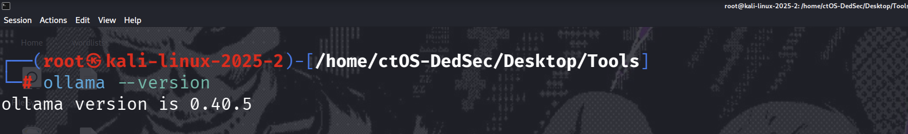
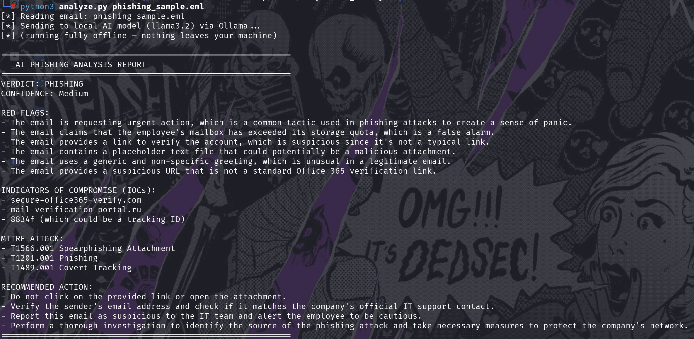

# 🤖 AI-Powered Phishing Email Analyzer (Local LLM)

> A SOC automation tool that feeds a suspicious email to an **AI model running fully locally** (via Ollama) and returns an automated analyst verdict — phishing or benign, red flags, extracted IOCs, MITRE ATT&CK mapping, and recommended actions — in seconds, with **nothing sent to the cloud**.
>
> The AI does the fast first pass; the human analyst verifies and decides. This "human-in-the-loop" design is how AI actually belongs in a SOC.


-black)


---

## 📌 Table of Contents
1. [Summary](#-summary)
2. [Why Local AI?](#-why-local-ai)
3. [How It Works](#-how-it-works)
4. [Setup & Run](#-setup--run)
5. [Example Output](#-example-output)
6. [Manual vs. AI Analysis](#-manual-vs-ai-analysis)
7. [The Catch: AI Hallucination & Human-in-the-Loop](#-the-catch-ai-hallucination--human-in-the-loop)
8. [What I Learned](#-what-i-learned)
9. [Disclaimer](#-disclaimer)

---

## 📝 Summary

Phishing triage is one of the most repetitive tasks in a SOC — an analyst reads the headers, spots the red flags, extracts the IOCs, and writes a verdict, over and over. This project automates that first pass with a **local AI model**.

In an earlier project I analyzed a phishing email **by hand**. Here I built a Python tool (`analyze.py`) that sends the same email to a locally-running LLM and gets back a structured analyst report in seconds. The result correctly identified the email as **phishing**, listed the real red flags (urgency, fake storage lure, lookalike domain, suspicious link), and extracted both malicious domains as IOCs — automatically.

---

## 🔒 Why Local AI?

A real SOC can't paste sensitive emails, logs, or customer data into ChatGPT or any cloud AI — that's a data-leak and compliance problem. This tool runs the model **entirely on the analyst's own machine** using **Ollama**, so:

- **Nothing leaves the network** — no cloud, no API calls, no data exposure.
- **No API key, no cost** — the model is free and local.
- **Works offline** — no internet needed once set up.

That on-premise design is the difference between "a cool AI demo" and "something a SOC could actually deploy."

---

## ⚙️ How It Works

```
 .eml file ──▶ analyze.py ──▶ parse headers + body ──▶ local LLM (Ollama) ──▶ structured analyst report
                                                         (runs on your machine)
```

1. `analyze.py` parses the email's headers (From, Reply-To, Authentication-Results, etc.) and body.
2. It wraps them in a SOC-analyst prompt and sends them to the local Ollama model via its API (`localhost:11434`).
3. The model returns a verdict, red flags, IOCs, MITRE mapping, and recommended actions.

The full tool is in [`analyze.py`](analyze.py) — about 100 lines of Python, no external libraries.

---

## 🔧 Setup & Run

**1. Install Ollama** (runs AI models locally):
```bash
curl -fsSL https://ollama.com/install.sh | sh
```



**2. Download a model and confirm the local AI works:**
```bash
ollama pull llama3.2
ollama run llama3.2 "Say hello in one sentence."
```


**3. Run the analyzer against a suspicious email:**
```bash
python3 analyze.py phishing_sample.eml
```

---

## 🖥️ Example Output



```
AI PHISHING ANALYSIS REPORT
============================================================
VERDICT: PHISHING
CONFIDENCE: Medium

RED FLAGS:
- Urgent action requested — classic panic tactic
- False "storage quota exceeded" alarm
- Suspicious verification link, not a real Office 365 URL
- Placeholder/malicious attachment
- Generic, non-specific greeting
- URL does not match a legitimate Office 365 domain

INDICATORS OF COMPROMISE (IOCs):
- secure-office365-verify.com
- mail-verification-portal.ru
- 8834f (possible tracking ID)

MITRE ATT&CK:
- T1566.001 Spearphishing Attachment

RECOMMENDED ACTION:
- Do not click the link or open the attachment
- Verify the sender against the real IT support contact
- Report to the SOC and warn the user
- Investigate the source and protect the network
============================================================
```

The AI ran **locally on Kali** — the `[*] running fully offline — nothing leaves your machine` line confirms it.

---

## ⚖️ Manual vs. AI Analysis

| | Manual analysis | AI analyzer (this tool) |
|---|---|---|
| Time per email | Several minutes | A few seconds |
| Consistency | Varies by analyst | Same checklist every time |
| Scales to 100s of emails | No | Yes |
| Data privacy | — | 100% local, nothing sent to cloud |
| Accuracy | High (expert) | Good first pass, needs verification |

**Takeaway:** AI doesn't replace the analyst — it removes the repetitive first-pass work so the human focuses on the decision.

---

## ⚠️ The Catch: AI Hallucination & Human-in-the-Loop

This project also demonstrates a **real limitation of AI in security** — and that's a feature of the writeup, not a bug.

In the output, the model correctly identified `T1566.001 Spearphishing Attachment`, but it also **invented two MITRE technique IDs** (`T1201.001` and `T1489.001`) that don't exist as phishing techniques. This is **AI hallucination** — the model producing confident-sounding but incorrect information.

**This is exactly why AI in a SOC must be "human-in-the-loop":** the analyst treats the AI's output as a fast draft to verify, never as ground truth. An analyst who blindly trusted this report would put wrong data in a ticket. Recognizing and catching that is the real skill — and it's why AI augments analysts rather than replacing them.

---

## 💡 What I Learned

- **How to integrate an LLM into a security workflow** — parsing an artifact, prompting a model, and structuring the output as an analyst report.
- **Why local/private AI matters for a SOC** — sensitive data can't go to cloud AI, so on-prem models (Ollama) are the deployable answer.
- **AI's strengths and limits** — fast, consistent triage, but prone to hallucination, so it needs human verification.
- **The right framing:** AI is an assistant that accelerates the analyst, not a replacement for judgment.

---

## ⚠️ Disclaimer

> This tool runs entirely on a machine I own, against a synthetic sample email created for this exercise. The AI model's output must always be verified by a human analyst before any action is taken — it is a first-pass assistant, not a final authority. Shared for educational and defensive purposes.

---

<p align="center"><i>An AI + SOC project — automating phishing triage with a local LLM, human-in-the-loop.</i></p>
